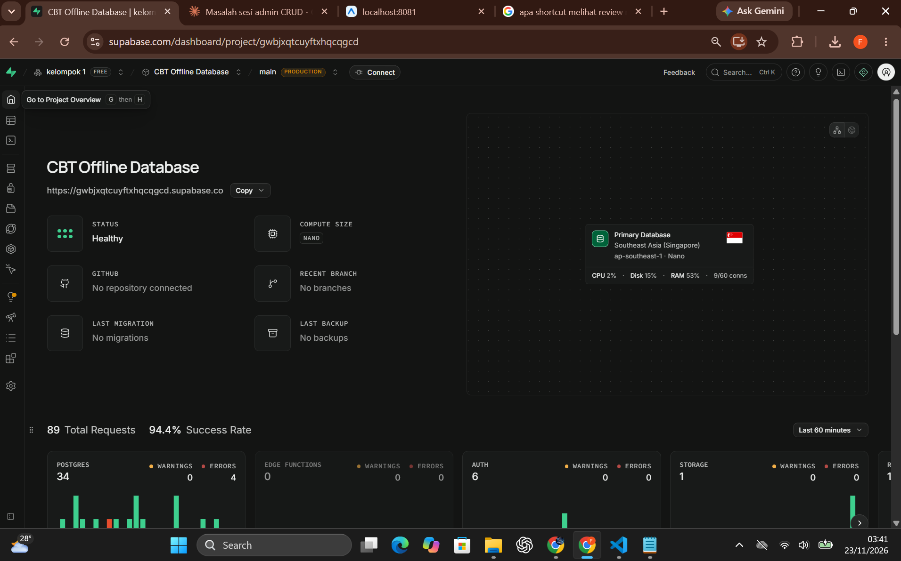
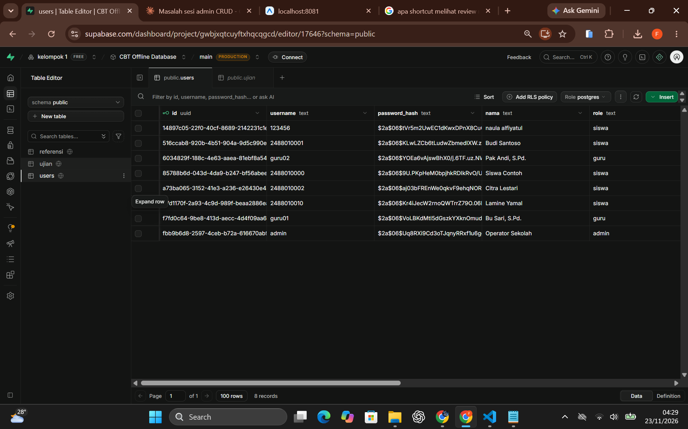
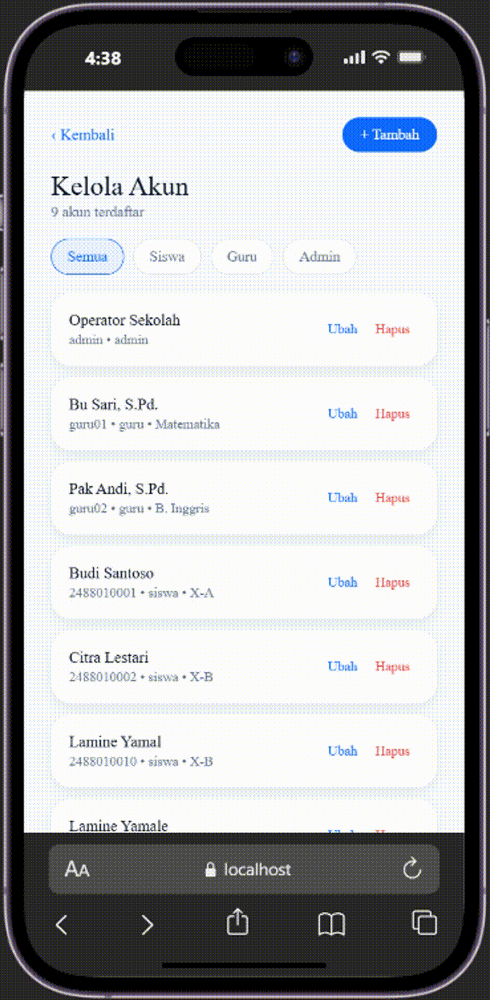
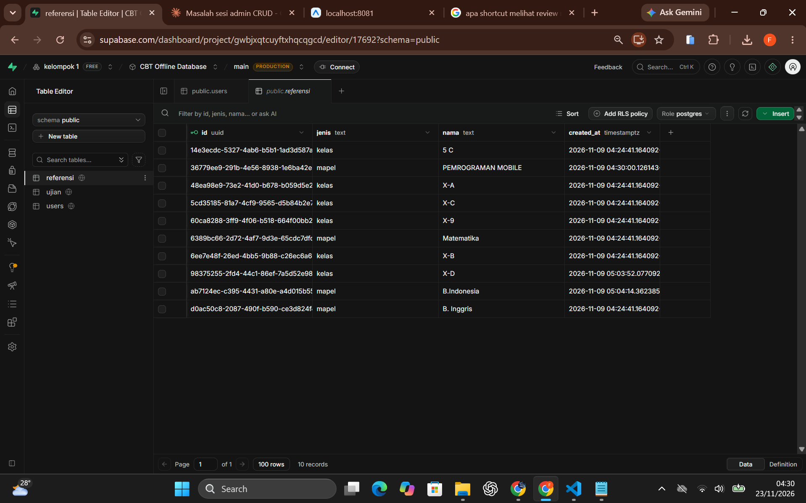
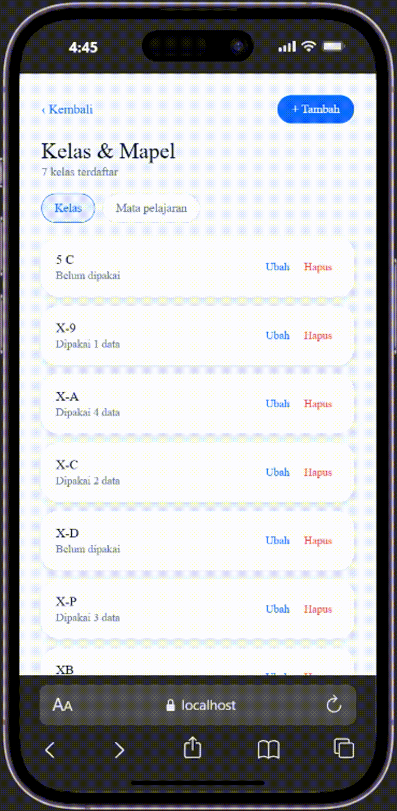
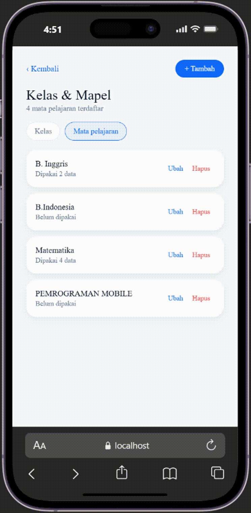
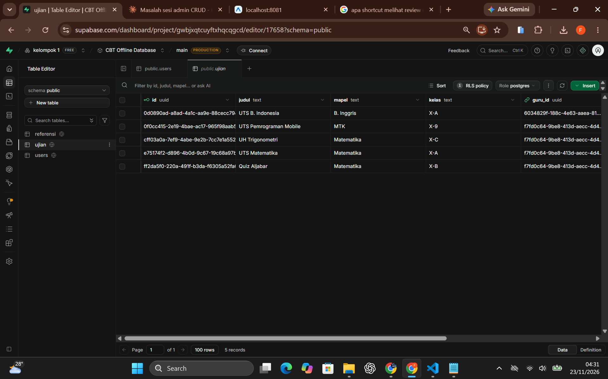
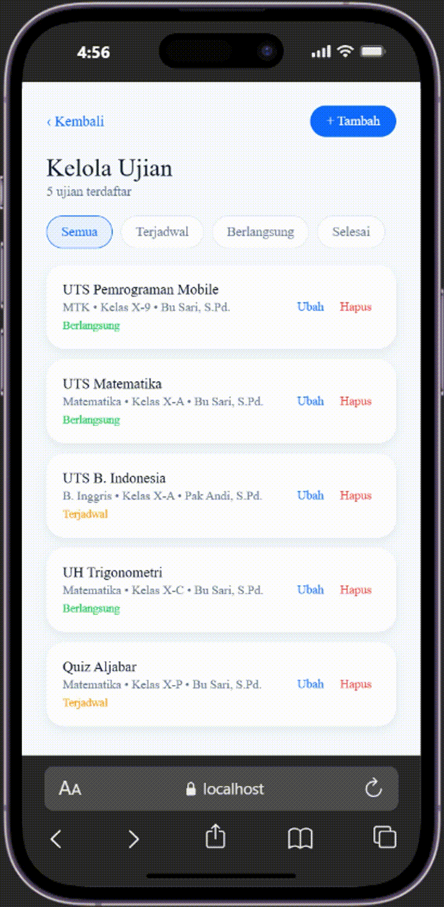

# LAPORAN TUGAS INTEGRASI DATABASE PROYEK CBT OFFLINE

# 1. Ringkasan

## 1.1 Deskripsi Proyek

CBT Offline merupakan aplikasi Computer Based Test (CBT) yang dikembangkan untuk mendukung pelaksanaan ujian berbasis perangkat digital.

Aplikasi dikembangkan menggunakan React Native dengan Expo. Supabase digunakan sebagai layanan backend dan database untuk penyimpanan, pengambilan, dan pengelolaan data akun, referensi (kelas dan mata pelajaran), serta informasi ujian.

## 1.2 Tujuan Integrasi Supabase

1. Menghubungkan aplikasi dengan database Supabase.
2. Menyediakan tempat penyimpanan data aplikasi.
3. Mendukung proses pengambilan dan pengelolaan data (CRUD).
4. Mengintegrasikan layanan backend dengan aplikasi React Native.
5. Mendukung pengelolaan akun pengguna, referensi, dan informasi ujian.
6. Menerapkan autentikasi: **siswa** menggunakan NISN dan password, sedangkan **guru dan admin** menggunakan Login Google (Supabase Auth OAuth).


# 2. Koneksi Supabase

Project Supabase dibuat melalui dashboard Supabase dengan nama **CBT Offline Database**. Project ini menyediakan database PostgreSQL dan layanan autentikasi untuk aplikasi.

Aplikasi terhubung ke Supabase melalui Supabase Client. URL dan anon key disimpan di file `.env`, sedangkan client dibuat di `src/lib/supabase.ts`.

```env
EXPO_PUBLIC_SUPABASE_URL=
EXPO_PUBLIC_SUPABASE_ANON_KEY=
```

**Bukti:**
- URL Supabase: https://supabase.com/dashboard/project/gwbjxqtcuyftxhqcqgcd
- Dashboard Supabase yang menunjukkan proyek aktif:



# 3. Struktur Database

## Struktur Database

**Tabel yang digunakan:**

| Tabel | Fungsi |
|---|---|
| `users` | Data akun pengguna (nama, peran, kelas/mapel), terhubung ke `auth.users` |
| `ujian` | Data ujian beserta guru pengampu dan statusnya |
| `referensi` | Daftar kelas dan mata pelajaran |


**Fungsi di server:** logika pengelolaan data yang tersimpan di database Supabase dan dipanggil oleh aplikasi.

| Fungsi | Kegunaan |
|---|---|
| `login_user` | Login siswa dengan NISN dan password |
| `get_oauth_profile` | Verifikasi akun Google guru/admin |
| `cek_admin_google` | Pengecekan peran admin dari sesi Google |
| `ringkasan_admin` | Jumlah siswa, guru, kelas, dan ujian terjadwal |
| `admin_list_users` | Daftar akun |
| `admin_create_user` | Tambah akun |
| `admin_update_user` | Ubah akun |
| `admin_delete_user` | Hapus akun |
| `admin_list_ujian` | Daftar ujian beserta nama guru |
| `admin_create_ujian` | Tambah ujian |
| `admin_update_ujian` | Ubah ujian |
| `admin_delete_ujian` | Hapus ujian |
| `admin_list_referensi` | Daftar kelas/mapel dan jumlah pemakaiannya |
| `admin_create_referensi` | Tambah kelas/mapel |
| `admin_update_referensi` | Ubah nama kelas/mapel, data terkait ikut diperbarui |
| `admin_delete_referensi` | Hapus kelas/mapel yang tidak dipakai |


# 4. Bukti Di Setiap Tabel dan Alur CRUD

## 4.1 Tabel `users`

**Fungsi:** Menyimpan akun pengguna beserta role, kelas/mapel, dan email Google.

Halaman aplikasi: **Kelola Akun**.

**Data pada Supabase:**



**Alur pengelolaan akun: Tambah, Ubah, dan Hapus**




## 4.2 Tabel `referensi`

**Fungsi:** Menyimpan data kelas dan mata pelajaran.

Halaman aplikasi: **Kelas & Mapel**.

**Data pada Supabase:**



**Alur pengelolaan referensi:**






## 4.3 Tabel `ujian`

**Fungsi:** Menyimpan informasi ujian (judul, mapel, kelas, guru, status).

Halaman aplikasi: **Kelola Ujian**.

**Data pada Supabase:**



**Alur pengelolaan ujian:**



