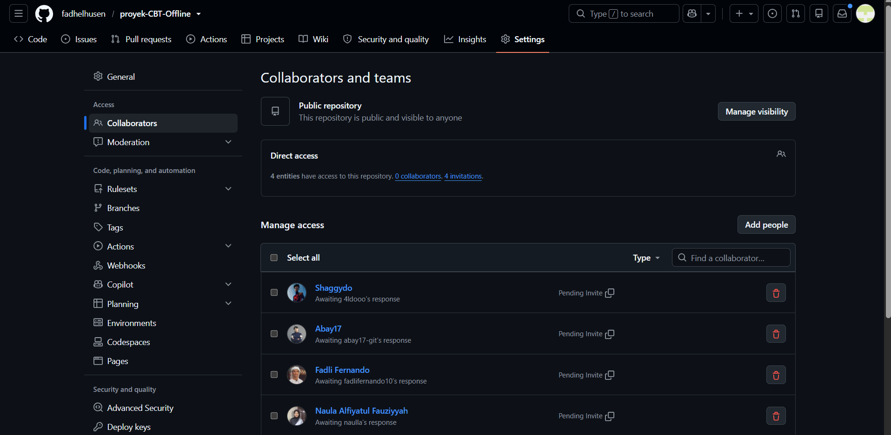
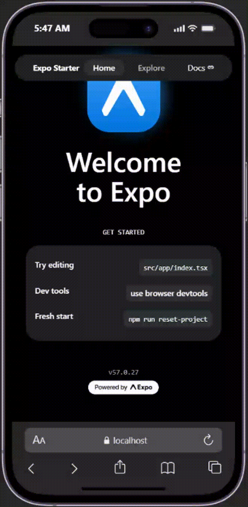
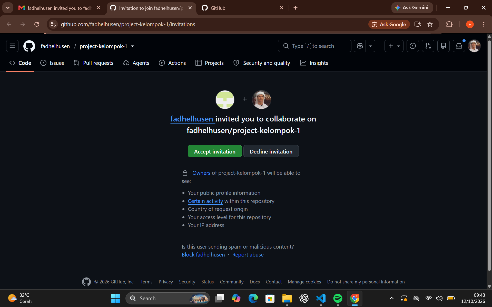
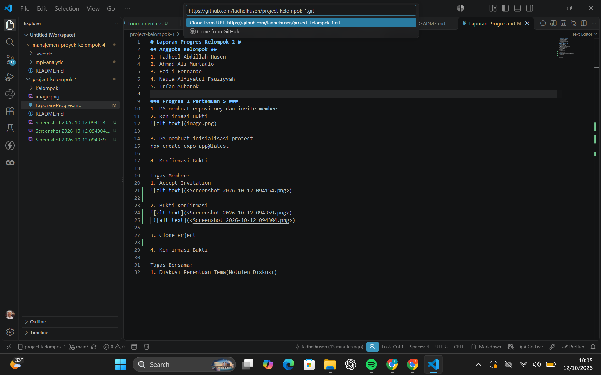

# Laporan Progres Kelompok 1 #
## Anggota Kelompok ##
1. Fadheel Abdillah Husen
2. Ahmad Ali Murtadlo
3. Fadli Fernando
4. Naula Alfiyatul Fauziyyah
5. Irfan Mubarok

### Progres 1 Pertemuan 5 ###
1. PM membuat repository dan invite member
2. Konfirmasi Bukti

3. PM membuat inisialisasi project
npx create-expo-app@latest

4. Konfirmasi Bukti

Tugas Member:
Fadli:
1. Accept Invitation
2. Bukti Konfirmasi

3. Clone Proyek
4. Bukti Konfirmasi

Aldo:
1. Accept invitation
2. Bukti Konfirmasi

3. Clone Proyek
4. Bukti Konfirmasi

Naula:
1. Accept invitation
2. Bukti konfirmasi

3. Clone proyek
4. Bukti konfirmasi

Irfan:
1. Accept invitation
2. Bukti konfirmasi

3. Clone proyek
4. Bukti konfirmasi

Tugas Bersama:
1. Diskusi Penentuan Tema

# Notulen diskusi Kelompok 1 #
Nama Kelompok   : Kelompok 1
Hari/Tanggal    : Kamis, 15 OKtober 2026
Tempat/Media    : Gedung Siber

## Agenda Diskusi ##
1.	Mengusulkan ide tema aplikasi mobile
2.	Menentukan target pengguna aplikasi

## Daftar Ide Tema ##

Fadheel:
* Tema : Sistem Manajemen Operasional UMKM Tahu Kocek (Inventaris Bahan Baku, Penjadwalan *Shift*, dan Rekap Laporan)
* Target: Pemilik Usaha

Fadli:
* Tema : Sistem Pengaduan Kerusakan Fasilitas Kampus
* Target: Seluruh Civitas Akademik

Aldo:

Naula :

Irfan :

## Hasil dan Keputusan ##
Tema yang diusulkan: Pengembangan Aplikasi *Computer-Based Test* (CBT) Offline
Alasan pemilihan: Ujian di MTs Darul Muttaqin masih dilakukan secara manual menggunakan kertas yang kurang efisien secara biaya dan waktu koreksi. Penggunaan ujian berbasis digital biasa terhambat oleh koneksi internet dan potensi kecurangan. Aplikasi CBT Offline ini dirancang untuk menyelesaikan kendala tersebut tanpa perlu bergantung pada koneksi internet yang stabil.
Target pengguna: Guru dan Siswa di MTs Darul Muttaqin.