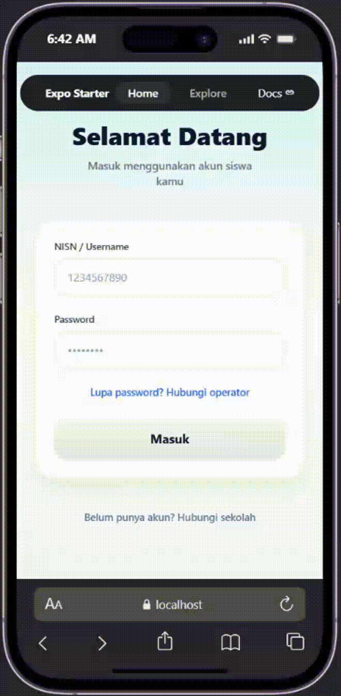

# Progress Pengembangan 2 — PEMMOB

## 1. Penentuan Tema dan Wawancara

### 1.1 Identitas Proyek
- **Nama kelompok:** Kelompok 1
- **Mata kuliah:** Pemrograman Mobile (PEMMOB)
- **Nama aplikasi:** CBT Offline
- **Tema proyek:** Pengembangan Aplikasi *Computer-Based Test* (CBT) Offline untuk Pelaksanaan Ujian Sekolah
- **Platform/teknologi:** React Native dengan Expo
- **Anggota kelompok:**
  1. Fadheel Abdillah Husen
  2. Fadli Fernando
  3. Ahmad Ali Murtadlo
  4. Naula Alfiyatul Fauziyyah
  5. Irfan Mubarok

### 1.2 Tema Proyek dan Hasil Wawancara

#### 1.2.1 Latar Belakang
Ujian seringkali dilakukan secara digital melalui aplikasi. Namun, pelaksanaannya masih menghadapi kendala, seperti keterbatasan perangkat, jaringan internet yang tidak stabil, serta potensi kecurangan karena siswa dapat mencari jawaban melalui internet. Oleh karena itu, kelompok kami mengembangkan aplikasi CBT Offline sebagai alternatif ujian digital yang lebih praktis, mengurangi penggunaan kertas, dan meminimalkan ketergantungan pada internet selama ujian berlangsung.

#### 1.2.2 Temuan Wawancara dan Kebutuhan Pengguna
Berdasarkan wawancara dengan guru dan siswa, pelaksanaan ujian masih dilakukan secara manual menggunakan kertas sehingga membutuhkan biaya pencetakan dan waktu untuk memeriksa jawaban. Selain itu, pelaksanaan ujian digital menghadapi kendala berupa keterbatasan perangkat, jaringan internet yang tidak stabil, serta potensi kecurangan karena siswa dapat mencari jawaban melalui internet saat ujian berlangsung.

#### 1.2.3 Kesimpulan Kebutuhan Pengguna
Berdasarkan hasil wawancara, kebutuhan pengguna terhadap aplikasi CBT Offline meliputi:
1. Sistem ujian dapat digunakan secara offline tanpa bergantung pada koneksi internet.
2. Mendukung soal pilihan ganda dan esai.
3. Menyediakan pemeriksaan otomatis untuk soal pilihan ganda.
4. Memiliki fitur pengacakan soal untuk meminimalkan kecurangan.
5. Mendukung tampilan teks berbahasa Arab.
6. Menampilkan soal dan gambar dengan jelas.
7. Membantu mengurangi penggunaan kertas dalam pelaksanaan ujian.

---

### 1.3 Bukti dan Notulensi Wawancara
- **Narasumber:** Ibu Rike dan Ibu Uum (Guru), Dua orang siswi MTs
- **Pewawancara:** Irfan, Fadheel, Fadli, Naula
- **Tanggal wawancara:** Jumat, 16 Oktober 2026
- **Media/tempat:** MTs Darul Muttaqin
- **Bukti wawancara:**

#### Notulensi Wawancara bersama Ibu Rike dan Ibu Uum (Guru)
1. **Bagaimana sistem/proses pelaksanaan ujian yang berlaku di sekolah saat ini?**
   - **Jawaban:** Pelaksanaan ujian di sekolah saat ini masih manual menggunakan kertas dan pensil. Ujian belum berbasis digital (belum menggunakan HP, laptop secara penuh, maupun perangkat terhubung lainnya).
2. **Apakah pelaksanaan ujian manual membutuhkan biaya operasional khusus (seperti penggandaan soal)?**
   - **Jawaban:** Ya, ada biaya pencetakan/penggandaan. Jumlah soal dan lembar jawaban yang dicetak disesuaikan secara manual dengan total siswa di kelas 7, 8, dan 9.
3. **Apakah sistem ujian manual berbasis kertas ini dirasa efektif? Apa kendala utamanya?**
   - **Jawaban:** Secara efisiensi zaman, sistem manual kurang efektif dibanding penggunaan HP/digital yang lebih praktis. Kendala utamanya adalah masalah sarana dan prasarana siswa. Sekolah berada di lingkungan perkampungan di mana masih banyak siswa yang belum memiliki HP sendiri (beberapa masih menggunakan HP milik orang tua).
4. **Apakah pihak sekolah menyediakan fasilitas laptop/perangkat komputer untuk siswa?**
   - **Jawaban:** Sekolah menyediakan unit laptop/komputer. Namun jumlahnya belum mencukupi untuk seluruh siswa secara bersamaan, sehingga pelaksanaan ujian berbasis komputer harus dibagi menjadi beberapa sesi (misal per sesi 10 siswa).
5. **Bagaimana proses rekapitulasi nilai hasil ujian? Siapa yang bertanggung jawab?**
   - **Jawaban:** Rekapitulasi dilakukan oleh masing-masing guru pengampu mata pelajaran. Guru mengoreksi lembar jawaban menggunakan tabel konversi penilaian. Setelah nilai akhir selesai direkap, data diserahkan ke operator sekolah untuk dimasukkan ke e-Rapor atau rekap nilai harian.
6. **Apakah pernah ditemui kasus di mana lembar jawaban diisi namun lupa diberi nama/identitas siswa?**
   - **Jawaban:** Pernah terjadi. Untuk mengantisipasinya, pengawas/guru akan memeriksa satu per satu ke meja siswa sebelum/saat ujian berlangsung untuk memastikan identitas pada LJK lengkap dan benar.
7. **Berapa lama waktu yang dibutuhkan guru untuk mengoreksi hasil ujian secara manual?**
   - **Jawaban:** Untuk Pilihan Ganda (PG) tergolong cepat karena menggunakan lembar kunci jawaban yang dilubangi. Untuk Esai, dibutuhkan waktu sekitar 1 jam per kelas (rata-rata 20 siswa per kelas).
8. **Bagaimana cara guru mendeteksi atau menyikapi siswa yang mencontek saat ujian berlangsung?**
   - **Jawaban:** Indikasi terlihat dari gerak-gerik fisik (tangan di bawah meja atau sering celingak-celinguk). Jika ditemukan kecurangan/jawaban persis sama antar siswa, yang bersangkutan dipanggil dan diuji ulang dengan soal baru untuk mengukur kemampuan aslinya.
9. **Apa saja jenis/bentuk soal yang biasa digunakan dalam ujian sekolah?**
   - **Jawaban:** Bentuk soal utama adalah Pilihan Ganda (PG) dan Esai. Komposisi Ujian Akhir Semester (ASAS): 40 PG, 5 Esai. Komposisi Ujian Tengah Semester (ASAT): 20 PG, 5 Esai.
10. **Untuk mata pelajaran PAI / Al-Qur'an Hadits, apakah ada bentuk ujian atau kebutuhan khusus dalam penulisan soal/jawaban?**
    - **Jawaban:** Ujian PAI meliputi tes tulis, lisan, dan praktik. Pada tes tulis (terutama Rumpun PAI, Al-Qur'an Hadits, dan Aqidah Akhlak), soal maupun jawaban sering membutuhkan lafaz/teks bahasa Arab.
11. **Apakah pernah terjadi kasus lembar jawaban siswa hilang saat pengumpulan/pemeriksaan?**
    - **Jawaban:** Belum pernah terjadi. Proses pengumpulan lembar jawaban langsung dicocokkan dan dihitung satu per satu sesuai dengan daftar hadir.

#### Notulensi Wawancara bersama Siswa (2 Orang Siswi MTs)
1. **Apa kendala yang dirasakan siswa selama mengerjakan ujian secara manual?**
   - **Jawaban:** Kadang terdapat kesalahan menulis (typo) atau penulisan yang kurang jelas pada lembar soal dari pihak pencetak.
2. **Apakah siswa pernah lupa mengisi identitas pada lembar jawaban?**
   - **Jawaban:** Pernah terjadi, namun biasanya segera diingatkan oleh guru/pengawas saat lembar dikumpulkan.
3. **Apa yang dilakukan siswa jika lembar jawaban esai tidak cukup/muat?**
   - **Jawaban:** Menyiasatinya dengan mengecilkan ukuran tulisan. Jika disediakan, siswa dapat meminta lembar jawaban tambahan.
4. **Bagaimana pengalaman siswa saat pernah mengerjakan ujian berbasis HP? Apakah lebih efektif?**
   - **Jawaban:** Lebih nyaman dan simpel dibanding ujian kertas karena tidak perlu membeli peralatan tulis. Pengerjaan terasa lebih cepat karena cukup menekan opsi jawaban tanpa pusing memikirkan ruang baris tulisan.
5. **Apa kendala utama saat menggunakan HP untuk ujian?**
   - **Jawaban:** HP terkadang lag/lemot dan sering terjadi kendala koneksi jaringan internet.
6. **Bagaimana jika ada gambar pada soal kertas yang buram/kurang jelas?**
   - **Jawaban:** Siswa akan mengonfirmasi atau menanyakannya secara langsung kepada pengawas ujian.
7. **Apakah pernah melihat indikasi kecurangan (seperti menyalin soal ke Google/AI) saat ujian berbasis HP?**
   - **Jawaban:** Siswa mengonfirmasi pernah melihat teman lain mencoba mencari jawaban secara daring (*searching*) saat ujian menggunakan HP.

---

## 2. Pembagian Tugas

### Role dan Hak Akses Tim
- **Fadheel Abdillah Husen:** Project Manager (PM) + Pengerjaan Halaman Login.
- **Irfan Mubarok:** Desain UI/UX menggunakan Figma.
- **Ahmad Ali Murtadlo (Aldo):** Pengerjaan Halaman Dashboard.
- **Fadli Fernando:** Pengerjaan Halaman Detail Ujian (Status Belum Download) & Fungsionalitas Download.
- **Naula Alfiyatul Fauziyyah:** Pengerjaan Halaman Detail Ujian (Status Sudah Download) & Fitur Token.

---

## 3. Rancangan Layar yang Telah Dibuat
1. Rancangan Halaman Login

2. Rancangan Halaman Dashboard

3. Rancangan Halaman Detail Ujian (belum download)

4. Rancangan Halaman Detail Ujian (Sudah Download) & Halaman Input Token

