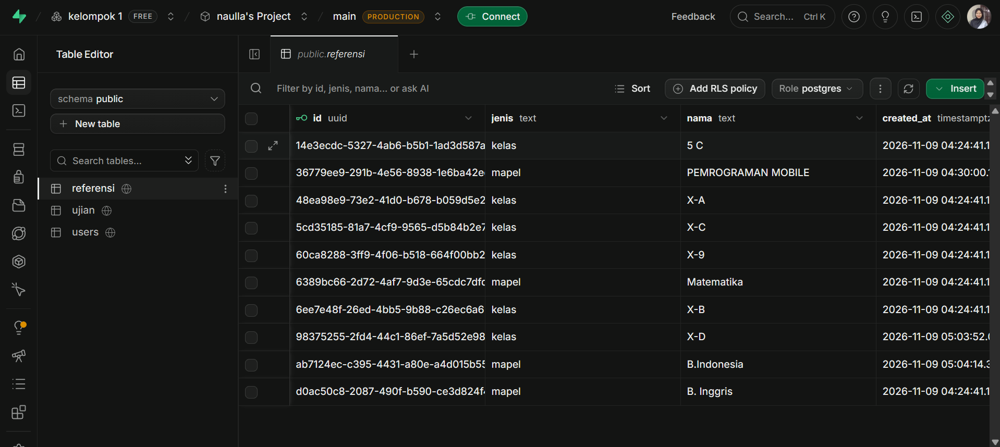
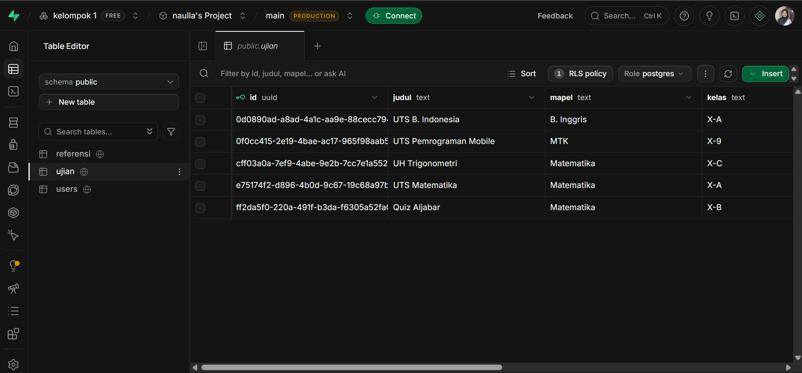
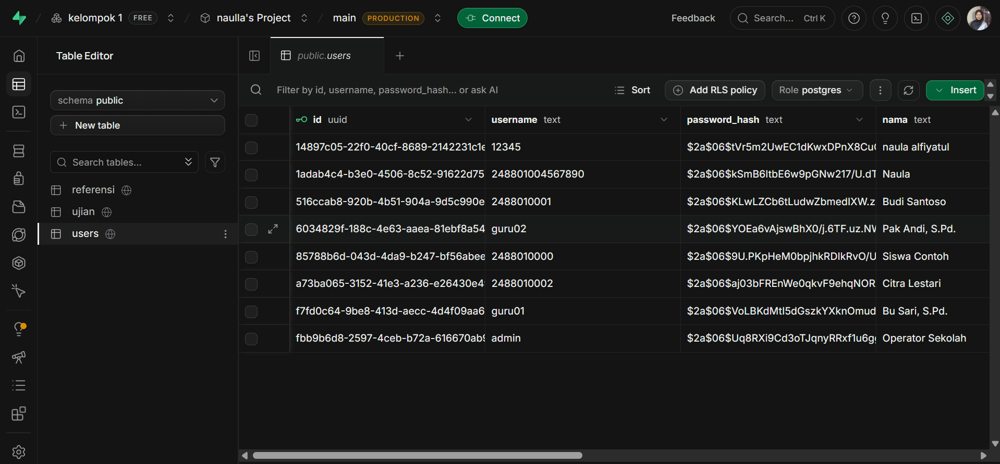

# Laporan Praktikum Pertemuan 9 — Pemrograman Mobile I
## Media Penyimpanan: CRUD dengan Supabase (Database + Cloud Storage)
### Studi Kasus: CBT offline

---

### Identitas Proyek & Praktikum

- **Mata Kuliah:** Pemrograman Mobile I
- **Pertemuan:** 9 (Media Penyimpanan)
- **Dosen Pengampu:** Mohamad Firdaus, M.Kom
- **Tanggal Praktikum:** November 2026
- **Kelas / Kelompok:** Kelas B / Kelompok 1
- **Pembagian Tugas Anggota Kelompok:**
  1. **Naula Alfiyatul Fauziyyah** Dashboard guru, Dashboard admin beserta CRUD

### Dokumentasi Bukti Pengerjaan (Screenshot & GIF)

#### Tabel `referensi` di Table Editor Supabase

#### Tabel `ujian` di Table Editor Supabase

#### Tabel `users` di Table Editor Supabase

#### CRUD Dashboard admin (belum bisa hapus)
